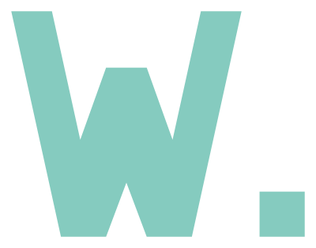

# Plan with AI. Ship with engineering control.

We build tools that help developers turn ideas into reviewed plans, make code changes, and preserve what they learn.

Our goal is simple: each completed task should make the next task better.

**[Get started →](https://docs.runwield.dev/quickstart/)** · [Documentation](https://docs.runwield.dev) · [Feedback](https://github.com/RunWield/runwield/issues)

## Our projects

| Project | What it does |
| :--- | :--- |
| **[RunWield](https://github.com/RunWield/runwield)** | The local coding-agent harness for planning, execution, verification, and durable work records. |
| **[Mnemoteca](https://github.com/RunWield/mnemoteca)** | Local memory for agents. |
| **[Skills](https://github.com/RunWield/skills)** | Portable planning, guidance, and code review skills. |
| **[Connect plugins](https://github.com/RunWield/plugins)** | Bring RunWield workflows into external coding-agent hosts. |

## Better work starts with what you learned

A code change should leave more than a diff. Plans, decisions, and work records give the next task a useful starting point, without making raw chat history the project knowledge base.

[Explore RunWield](https://runwield.dev) · [Get in touch](mailto:beta@runwield.dev)
